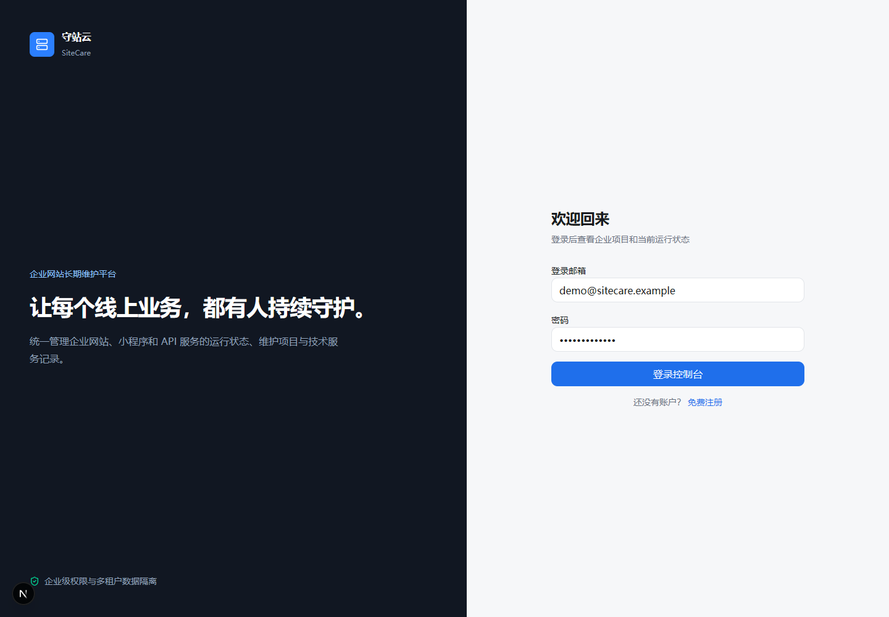
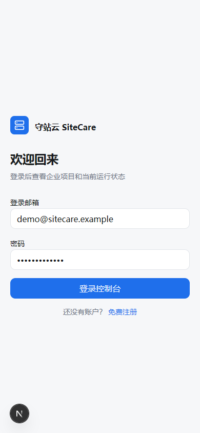

# SiteCare — Multi-tenant Web Application

A personal, AI-assisted portfolio project by **Chengchao Hu**, built with Next.js, React, TypeScript, Prisma and PostgreSQL.

This is a first-stage prototype demonstrating reusable UI, validated forms and organization-scoped data access. It is not a deployed client product or a WordPress theme.

## Code tour

| Capability | Source |
| --- | --- |
| Responsive UI | [Authentication layout](src/components/auth/auth-shell.tsx), [navigation](src/components/layout/app-navigation.tsx) |
| Reusable components | [UI components](src/components/ui) |
| Forms, loading states and errors | [Authentication form](src/components/auth/auth-form.tsx) |
| Validation and transactions | [Registration actions](src/app/%28auth%29/actions.ts), [project creation](src/app/%28dashboard%29/projects/actions.ts) |
| Authentication and roles | [Auth.js](src/auth.ts), [tenant guards](src/lib/auth/tenant.ts) |
| Organization-scoped queries | [Project data access](src/lib/dal/projects.ts) |
| Data modeling | [Prisma schema](prisma/schema.prisma) |
| Automated checks | [Validation tests](src/lib/validations/project.test.ts) |

## Screenshots





The interface is in Chinese; this guide is in English.

## Implemented scope

- Credentials-based sign-in and registration, hashed passwords and session handling.
- Organization membership and role guards.
- Project listing and creation scoped to the current organization.
- Dashboard presentation, reusable controls and theme toggle.
- Synthetic seed data for local exploration.

Monitoring workers, real uptime collection, incidents, tickets, email delivery and production deployment are **not implemented**. Dashboard health figures are demo data. Future-feature schema definitions do not imply those features work.

## Run locally

Requirements: Node.js 20.9+, npm and PostgreSQL. Use a disposable local database.

```sh
npm ci
cp .env.example .env
# Edit DATABASE_URL for your local database.
# Set AUTH_SECRET to a fresh random value of at least 32 characters.
npm run db:generate
npm run db:push
npm run db:seed
npm run dev
```

On PowerShell, use `Copy-Item .env.example .env`. Open http://localhost:3000.

Local demo login: `demo@sitecare.example` / `SiteCare@2026`. These are public development credentials. Never deploy the demo accounts unchanged.

## Checks

```sh
npm test
npm run typecheck
```

The suite covers valid project input, malformed URLs and optional-field normalization. It is not an end-to-end authentication or tenant-isolation security audit. See [verification notes](docs/VERIFICATION.md) for exactly what was run.

## Background and authorship

This self-initiated project was developed with AI assistance, including code generation and documentation. It is an inspectable project sample, not a claim of professional employment, commercial deployment or unaided authorship. This publication adds an English guide and clearly synthetic seed identities to the existing project.

For WordPress applications, it shows transferable React/TypeScript, layout, form and data-modeling work. It does not establish PHP, WordPress plugin or theme experience.

## Data handling

Only source code, dependency manifests, screenshots and placeholder configuration are published. Real environment files, databases, build output, dependencies and caches are excluded. Seed contacts are synthetic and use reserved `.example` domains.

